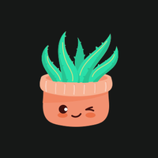
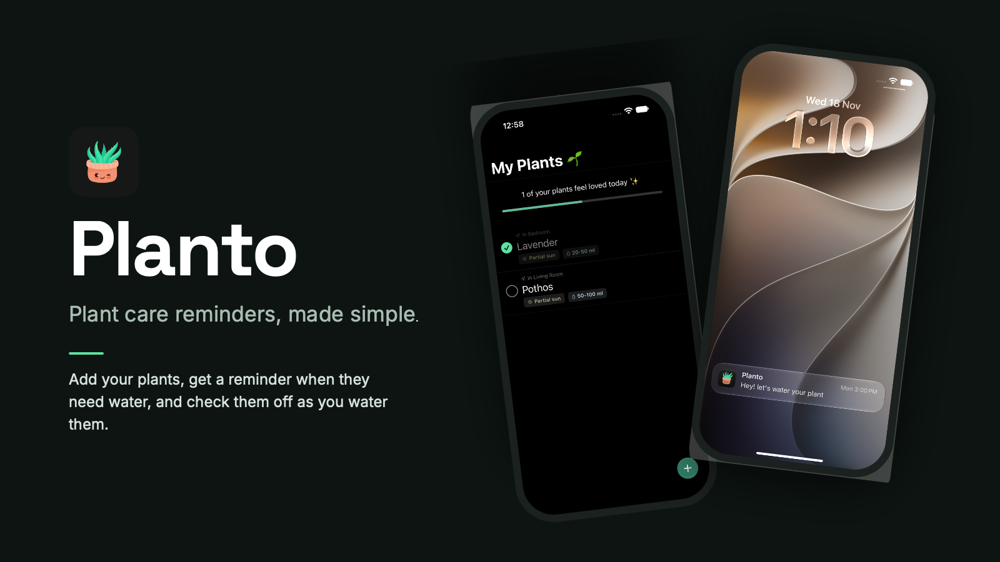
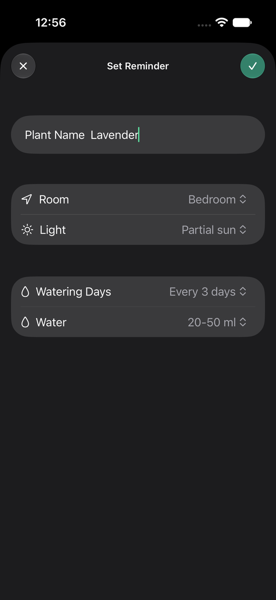
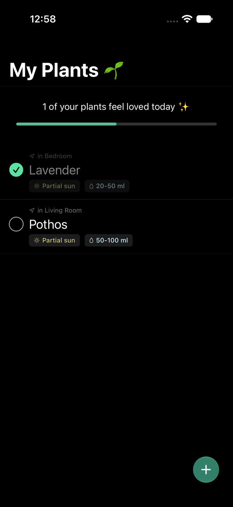

&#x20;<p align="center">
&#x20; 
</p>

<h1 align="center">Planto 🌱</h1>

<p align="center">   A plant care reminder app for iOS.<br>   Add your plants, get a reminder when they need water, and check them off when you water them 💦 </p>

<p align="center">
  
  
  
  
</p>

---

<p align="center">    </p>

## Screenshots

<p align="center">          </p>

<p align="center">          </p>

## Features


- 🌿 Add a plant with its name, room, light and water amount
- 📅 Choose how often to water it, from every day to every 2 weeks
- ✏️ Tap a plant to edit it, or swipe to delete it
- ✅ Check off a plant when you water it and watch the progress bar fill up
- 🔔 Get a reminder on the days your plants need water
- 💾 Your plants stay saved on your phone

## Built With

|                   |                           |
| ----------------- | ------------------------- |
| **Language**      | Swift                     |
| **UI**            | SwiftUI                   |
| **Architecture**  | MVVM with `@Observable`   |
| **Storage**       | UserDefaults and Codable  |
| **Notifications** | UserNotifications (local) |


## Getting Started

1. Clone the repository
   ```bash
   git clone https://github.com/YOUR-USERNAME/Planto.git
   ```
2. Open `Planto.xcodeproj` in Xcode
3. Choose a simulator and press **Run**


---

<p align="center">Made by Rawan 🌿</p>
