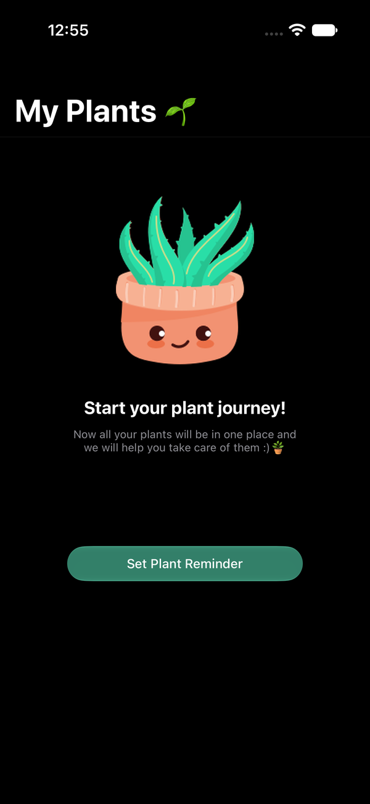
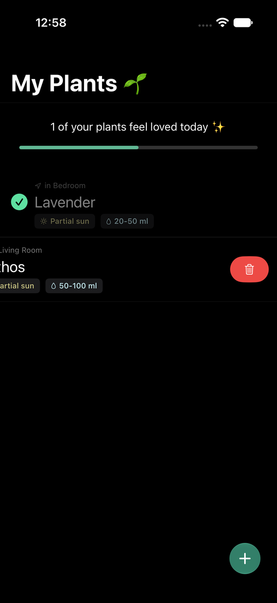
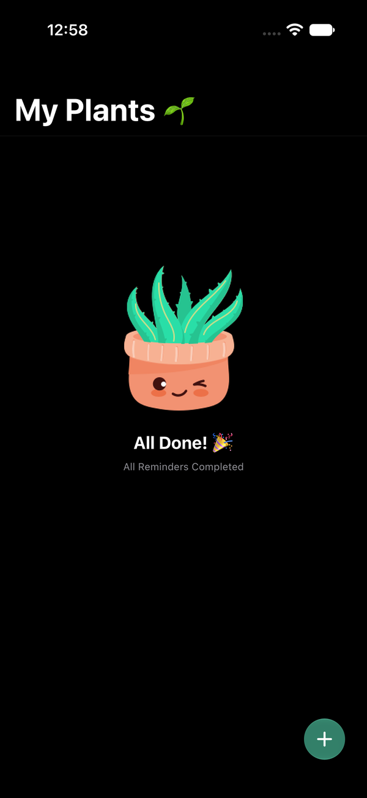
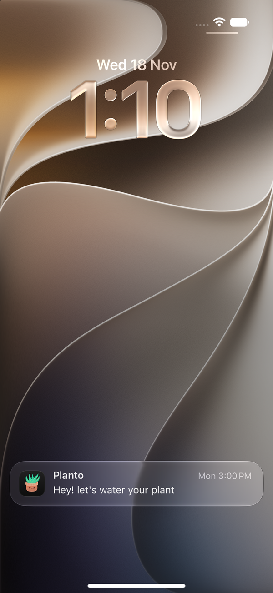

&#x20;<p align="center">
&#x20; 
</p>

<h1 align="center">Planto 🌱\</h1>

<p align="center">   A plant care reminder app for iOS.\<br>   Add your plants, get a reminder when they need water, and check them off when you water them 💦 \</p>

<p align="center">   \   \   \   \ \</p>

---

<p align="center">    </p>

## Screenshots

<p align="center">          </p>

<p align="center">          </p>

## Features

- 🌿 Add a plant with its name, room, light and water amount
- 📅 Choose how often to water it: every day, 2 days, 3 days, once a week, 10 days or 2 weeks
- ✏️ Tap a plant to edit it, or swipe it to delete it
- ✅ Check off a plant when you water it and watch the progress bar fill up
- 🎉 Get a happy "All Done" screen when all your plants are watered
- 🔔 Get one reminder at 3 PM on the days your plants need water, grouped in a single notification
- 🔕 No reminder for plants you already watered
- 💾 Your plants stay saved on your phone
- 🌙 Dark mode design with Liquid Glass buttons

## Built With

|                   |                           |
| ----------------- | ------------------------- |
| **Language**      | Swift                     |
| **UI**            | SwiftUI                   |
| **Architecture**  | MVVM with `@Observable`   |
| **Storage**       | UserDefaults and Codable  |
| **Notifications** | UserNotifications (local) |

## Project Structure

```text
Planto
├── Models          Plant data and watering options
├── ViewModels      App logic (saving, deleting, progress, screen state)
├── Views           Screens and small reusable components
├── Services        Notification scheduling
└── Theme           Colors and glass effect
```

The Views only display things. All the logic lives in the ViewModels, and the notifications live in their own service.

## Getting Started

1. Clone the repository
   ```bash
   git clone https://github.com/YOUR-USERNAME/Planto.git
   ```
2. Open `Planto.xcodeproj` in Xcode
3. Choose a simulator and press **Run**

Liquid Glass buttons need iOS 26 or later. On older versions the buttons use a simple colored background.

---

<p align="center">Made by Rawan 🌿</p>
